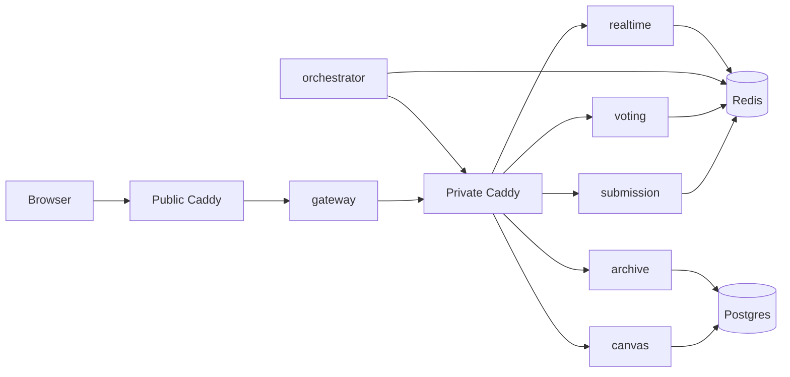

# Let's Write Together

One shared document. One word a minute. Everyone gets a say.

Let's Write Together is a turn-based crowd essay. The page is a single document for the current UTC day. Every minute, anyone online can submit one fragment and vote on the fragments submitted in that minute. When the minute ends, the winning fragment is appended. The next minute starts with an empty ballot. A full day is at most 1,440 fragments, one for each minute that actually elected one.

The screen is the document. A light red box after the last word opens the round. Past days that contain at least one winning word are listed as paper files and loaded only when opened.

## How a minute works

The server clock is Redis `TIME`. Nothing else is allowed to decide the round.

- `round_id = floor(unix_seconds / 60)`
- The first 30 seconds are open for submissions. After that the composer closes.
- Voting stays open for the whole minute, including the submission window.
- Each device may submit one fragment per minute and may change its vote until the minute ends.
- You can vote for any submitted fragment, including your own.
- Vote counts stay hidden until the minute ends.
- The fragment with the most votes is appended.
- If two or more fragments share that top count, the one submitted first wins. Submission order is the numeric word id assigned when the text was first accepted.
- If nobody submitted, or nobody voted, the minute is skipped. Nothing is appended and the document does not grow a blank slot.

The browser greys the composer when the submit window closes and shows "Voting only, submit a word in the first 30 seconds of the next minute." The server still enforces the window: a late submit is `409 SUBMISSION_CLOSED`, and a vote for a round that is no longer current is `409 VOTING_CLOSED`.

## The page

The document is a flat white US Letter sheet on a cream background. When the text fills a sheet, another sheet is added underneath. Spacing follows the essay: a normal word gets one space before it, and punctuation that binds to the previous word does not.

**How it works** sits under the title and expands in place.

**Past submissions** opens the last 31 days that actually contain a winning word. Dates are shown on file icons. A day's text is fetched the first time that file is opened and then kept in memory.

The round dialog has:

- Two clocks at the top: time left to submit a word, and time left to vote.
- A search field. Typing filters the in-memory list and is case-sensitive. Search refetches the ballot so a fragment accepted in that second can appear.
- The ballot, as selectable buttons that wrap to about four to six per line. The list is shuffled per device so an early fragment is not on top for everyone. Your own fragment is tagged "yours". The fragment you are voting for is highlighted with a star.
- A composer that accepts one fragment during the first 30 seconds.

## What counts as the same word

The ballot keeps the exact text. Two submissions share one vote button only when every character matches, including case, spaces, and punctuation.

`hello`, `heLLO`, `HELLO`, `hello!`, and `hello-` are five candidates. `h e l l o` is not `hello`. A second device that sends an identical string joins the existing candidate and has still used its one submission for the minute. The next minute starts empty, so a fragment that already won today can be submitted again.

A fragment is 1–48 characters after trimming only the leading and trailing whitespace. Internal spaces stay. Letters A–Z and essay punctuation are allowed anywhere:

`. , ! ? ; : ' " - — – … ( ) [ ] { } ‘ ’ “ ” & /`

Digits and other symbols (`@ # $ % *` and the rest) are rejected with `422 BAD_WORD`. Non-ASCII letters such as `café` are rejected.

## Moderation

The blocklist does not see the ballot text. It sees a letter core: casefolded, accents stripped, spaces and the punctuation above removed. `HELLO`, `hello!`, and `h e l l o` therefore hit a ban on `hello`. A fragment that is only punctuation has an empty letter core, skips the lists, and is allowed.

Matching is exact on that core. There is no substring match and no edit distance.

1. Latin-script lists from [LDNOOBW](https://github.com/LDNOOBW/List-of-Dirty-Naughty-Obscene-and-Otherwise-Bad-Words), used under [CC BY 4.0](data/blocklist/LICENSE).
2. If the core is not on the English allowlist, an Indic phonetic skeleton is compared with lemmas in `data/blocklist/indic.txt`. The allowlist is what keeps ordinary words such as `classic` off that tier.
3. Exact Arabizi, Latin-transliterated Russian, and a short hand list for other romanizations.

A hit is `422 WORD_REJECTED` and is never published. A pass publishes the original text, not the letter core. No list blocks every language. Spellings that are not on a list pass until a lemma is added.

## Architecture

Seven Go 1.23 services. Public writes are REST. Live updates are Server-Sent Events. Redis holds the live minute. Postgres stores essays and nothing else on the hot path. Service-to-service REST goes through one private Caddy proxy. The public Caddy site talks only to the gateway and does not route `/internal`.



| Service | Role |
| --- | --- |
| gateway | Mints the device cookie, rate-limits, serves the page, and forwards public REST to the private proxy. |
| submission | Checks the charset and blocklist, stores one exact text per round, and publishes `word.approved`. |
| voting | Applies votes in one Redis Lua script. Tallies the minute when the orchestrator asks. Does not publish per-vote counts. |
| orchestrator | Holds the lease, closes each minute, appends a winner or records a skip, and asks archive to seal at UTC midnight. |
| canvas | Appends a winning fragment, idempotent on `(day, round)`. Serves today, one past day, and the list of days that have words. |
| archive | Seals a UTC day and deletes days older than 31. It is the only service that deletes rows. |
| realtime | Holds SSE sockets and fans out `word.approved`, `round.phase`, `round.winner`, and `round.skipped`. A slow client is dropped. |

Submission, voting, canvas, archive, and realtime do not call each other. Redis pub/sub does not go through the proxy.

The orchestrator is the only writer of the phase key. It takes a Redis lease (`SET NX PX`) and renews it. If it loses the lease it does not close a round. A stored outcome makes a retry a no-op, so a skip cannot later become a blank slot and a winner cannot be appended twice. The unique key is `(day, round_number)`.

## Public API

The browser calls these on the public site. `POST /v1/sessions` and `GET /v1/rounds/current` are answered by the gateway. Everything else is proxied.

| Method | Path | Body / result |
| --- | --- | --- |
| `POST` | `/v1/sessions` | Sets an HttpOnly `did` cookie, HMAC-signed, for one year. |
| `GET` | `/v1/rounds/current` | `round_id`, `phase`, `server_time`, time left to submit, time left to vote, and the shuffle seed. |
| `POST` | `/v1/rounds/{id}/words` | `{ "text", "seq" }`. One submission per device per minute. |
| `GET` | `/v1/rounds/{id}/words` | Approved fragments for this minute. No counts. |
| `PUT` | `/v1/rounds/{id}/vote` | `{ "word_id", "seq" }`. Last write wins for `(round, device)`. |
| `GET` | `/v1/events` | SSE: `word.approved`, `round.phase`, `round.winner`, `round.skipped`. |
| `GET` | `/v1/canvas/today` | Today's winning fragments, in election order. `Cache-Control: no-store`. |
| `GET` | `/v1/canvas/days` | Dates in the last 31 days that have at least one winner. |
| `GET` | `/v1/canvas/{day}` | One sealed or open day. A sealed day may be cached. |

Errors are `application/problem+json`. Codes include `SUBMISSION_CLOSED`, `VOTING_CLOSED`, `ALREADY_SUBMITTED`, `WORD_REJECTED`, `BAD_WORD`, and `STALE_SEQ`. A stale vote is HTTP 200 with `STALE_SEQ` and writes nothing. The client keeps a monotonic `seq` per round in `sessionStorage`. An older retry cannot overwrite a newer vote.

## Internal API

These routes require `X-Internal-Token`. The public Caddyfile does not route `/internal`, and the private proxy is not published. The orchestrator is the only caller.

| Method | Path | Effect |
| --- | --- | --- |
| `POST` | `/internal/v1/rounds/{id}/tally` | Winner, or a skip when the ballot was empty or received no votes. |
| `POST` | `/internal/v1/canvas/append` | Insert the winning fragment for that UTC day and round. |
| `POST` | `/internal/v1/days/{day}/seal` | Seal the day and drop days older than 31. |

## Storage

Redis holds the live minute: phase, lease, exact-text dedupe, word ids, per-device submission, per-device vote, tally, and the closed-round outcome. Round keys expire after 180 seconds. The closed-round marker is kept for 48 hours. Redis is capped at 256 MB with `volatile-lru`.

Postgres 16 stores `days` and `slots`. A slot exists only for a minute that elected a fragment. `word` is never null. Canvas reads Redis `TIME` when it decides what "today" means, so the essay day matches the orchestrator's UTC day.

## Run it locally

Docker Compose publishes the public site on port 80 without TLS, so a lab machine can open it directly. Production should put Cloudflare in front of that port, cache sealed days, and neither cache nor buffer `/v1/events`.

```bash
docker compose up --build -d
```

Open `http://localhost/`.

The Compose file uses local defaults: Postgres user, password, and database `colorbook`, `COOKIE_SECRET=dev-cookie-secret`, and `INTERNAL_TOKEN=dev-internal-token`. Change those before exposing a host. Set `COOKIE_SECURE=1` only when the public site is HTTPS. The image tag shared by the Go services is `colorbook:local`. The page, stylesheet, and script are embedded in the gateway binary, so a UI change needs `docker compose up --build -d gateway`.

Go 1.23 is the language version. Tests use the standard toolchain:

```bash
go test ./...
```

`cmd/load` is a small crowd against the public origin. Words are letters only, because digits are rejected.

```bash
go run ./cmd/load -url http://localhost -painters 20 -viewers 20 -hold 3s
```

## Layout

```
cmd/            one main package per service, plus cmd/load
internal/       clock, words, filter, essay join, Redis scripts, and each service
web/            the page, embedded by the gateway
deploy/         public Caddyfile and the private proxy Caddyfile
data/blocklist  vendored lists and data/blocklist/LICENSE
```

The module path is `colorbook`. The name on the page is Let's Write Together.

## Host

The intended host is one VM with 2 cores and 12 GB of RAM. Compose runs public Caddy, the private proxy, Redis, Postgres (`shared_buffers=256MB`), and the seven Go binaries. Listeners are cheap because SSE is idle between fragments. The sharp moment is a burst of votes in the last second: gateway, private proxy, voting, one Lua script. Raise the open-file limit before expecting thousands of SSE sockets.
