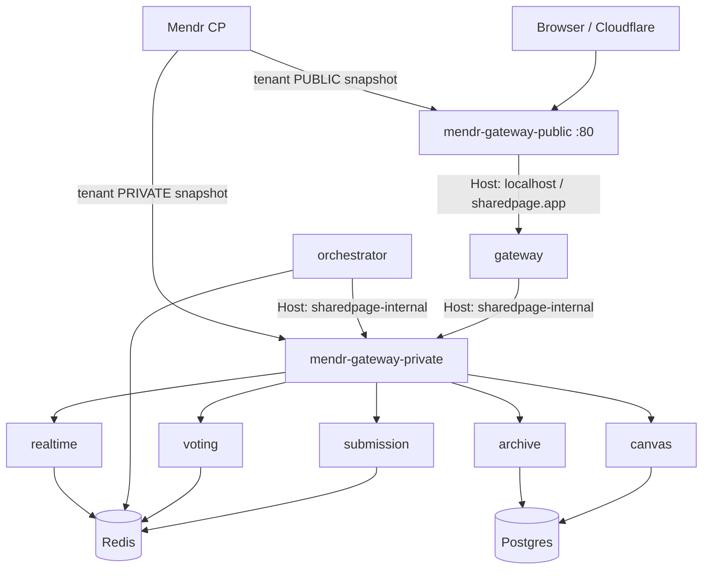

# Mendr integration

Colorbook fronts browser and mesh traffic with **two** Mendr data-plane edges (public + private), each synced from its **own control-plane tenant**. That way the public edge never receives `/internal` routes. Redis pub/sub and Postgres stay direct. Device sessions and Ed25519 service JWTs stay in Go.

## Topology



Hop count matches the old dual-Caddy design (browser → public edge → gateway → private edge → service). No extra latency.

## Why two tenants

Mendr syncs the **full tenant snapshot** to every edge of that tenant. One tenant with two edges would still put `sharedpage-internal` routes on the public edge (spoofable Host). Separate tenants give complete isolation: the public edge physically cannot route `/internal/*`.

## Host table

| Host | Edge | Allowed targets |
|------|------|-----------------|
| `localhost` | public | `sharedpage-gateway` only |
| `sharedpage.app` | public | `sharedpage-gateway` only |
| `sharedpage-internal` | private | submission, voting, canvas, archive, realtime |

## Service registry

| Service name | Instance base URL | Tenant / host |
|--------------|-------------------|---------------|
| `sharedpage-public` | synthetic source | PUBLIC — identity for `localhost` |
| `sharedpage-public-prod` | synthetic source | PUBLIC — identity for `sharedpage.app` |
| `sharedpage-gateway` | `http://gateway:8080` | PUBLIC target + PRIVATE identity source |
| `sharedpage-submission` | `http://submission:8080` | PRIVATE — `sharedpage-internal` |
| `sharedpage-voting` | `http://voting:8080` | PRIVATE — `sharedpage-internal` |
| `sharedpage-canvas` | `http://canvas:8080` | PRIVATE — `sharedpage-internal` |
| `sharedpage-archive` | `http://archive:8080` | PRIVATE — `sharedpage-internal` |
| `sharedpage-realtime` | `http://realtime:8080` | PRIVATE — `sharedpage-internal` |

OpenAPI uses `x-mendr-service`, `x-mendr-source`, and `x-mendr-host`. Public specs live under `localhost` / `sharedpage.app`; private specs under `sharedpage-internal`.

## Env reference

| Variable | Who | Meaning |
|----------|-----|---------|
| `MENDR_CONTROL_PLANE_URL` | both edges | CP base URL |
| `GATEWAY_EDGE_API_KEY_PUBLIC` | public edge + register | Public-tenant `mendr_…` key |
| `GATEWAY_EDGE_API_KEY_PRIVATE` | private edge + register | Private-tenant `mendr_…` key |
| `MENDR_TENANT_ID_PUBLIC` | public edge | Default `…0001` |
| `MENDR_TENANT_ID_PRIVATE` | private edge | Default `…0002` |
| `GATEWAY_INTERNAL_API_KEY` | optional | CP `X-Internal-Api-Key` for `/api/internal` |
| `PROXY_URL` | gateway, orchestrator | `http://mendr-gateway-private:80` |
| `PROXY_HOST` | gateway, orchestrator | `sharedpage-internal` |
| `PUBLIC_HOST` / `PUBLIC_HOST_PROD` | register | Public ingress hosts |
| `PRIVATE_HOST` | register | Default `sharedpage-internal` |
| `MENDR_AUTO_REGISTER` | register | `true` to register on deploy |
| `MENDR_UPSTREAM_ALLOW_CIDRS` | both edges | Phase 0 SSRF allow-list (Docker RFC1918); empty → `SSRF-filtered` on `172.16/12` etc. |

See `.env.mendr.example`.

## Compose services

- `mendr-gateway-public` — publishes `:80` / `:8080` locally; image `teammendr/themendr:latest` (needs **arm64** on Oracle A1)
- `mendr-gateway-private` — **no published ports**
- `mendr-edge-redis-public` / `mendr-edge-redis-private`
- `mendr-register-public` / `mendr-register-private` (`MENDR_SIDE=public|private`)

## SSE and `/internal`

- Gateway sets `FlushInterval = -1`. Mendr ingress uses `proxy_buffering off`.
- `/internal/*` exists only on the **private** tenant/edge. Spoofing `Host: sharedpage-internal` against the public edge returns no route.

## Deploy rule

Both edges share the colorbook Docker network so `http://gateway:8080` resolves. Control plane may live elsewhere (e.g. Netcup). Create the private tenant (`…0002`) and mint both edge keys on the CP before first deploy.

## Ops

```bash
./mendr/scripts/deploy.sh          # up + register both sides
# or
docker compose --env-file .env.mendr up --build -d
docker compose --env-file .env.mendr run --rm mendr-register-public
docker compose --env-file .env.mendr run --rm mendr-register-private
```

Onboarding: [MENDR_ONBOARDING_RUNBOOK.md](MENDR_ONBOARDING_RUNBOOK.md). ADR: [adr/0002-two-mendr-edges.md](adr/0002-two-mendr-edges.md).
