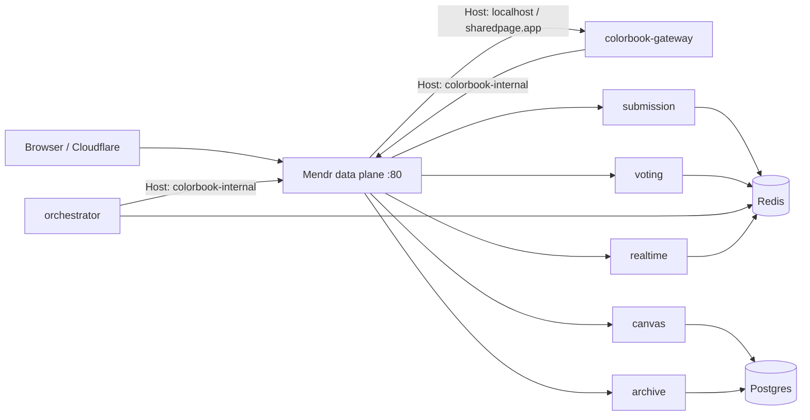

# Mendr integration

Colorbook fronts browser and mesh traffic with **one** Mendr data-plane edge. Redis pub/sub and Postgres stay direct. Device sessions and Ed25519 service JWTs stay in Go.

## Topology

## Host table

| Host | Purpose | Allowed targets |
|------|---------|-----------------|
| `localhost` | Local public | `colorbook-gateway` only |
| `sharedpage.app` | Production public | `colorbook-gateway` only |
| `colorbook-internal` | Private mesh | submission, voting, canvas, archive, realtime |

Public hosts must **not** route `/internal/*`. That invariant is “routes only exist under `colorbook-internal`.”

## Service registry

| Service name | Instance base URL | Ingress host(s) for its routes |
|--------------|-------------------|--------------------------------|
| `colorbook-public` | synthetic source (no upstream required) | identity for `localhost` |
| `colorbook-public-prod` | synthetic source | identity for `sharedpage.app` |
| `colorbook-gateway` | `http://gateway:8080` | public paths (as **target**); private identity source |
| `colorbook-submission` | `http://submission:8080` | `colorbook-internal` |
| `colorbook-voting` | `http://voting:8080` | `colorbook-internal` |
| `colorbook-canvas` | `http://canvas:8080` | `colorbook-internal` |
| `colorbook-archive` | `http://archive:8080` | `colorbook-internal` |
| `colorbook-realtime` | `http://realtime:8080` | `colorbook-internal` |

OpenAPI uses `x-mendr-service` (target), `x-mendr-source` (caller identity), and `x-mendr-host` (ingress table). CP resolves ingress host **per source app** from the OpenAPI registry — keep private imports on `colorbook-internal` and use two public source apps for the two public hosts.

## Env reference

| Variable | Who | Meaning |
|----------|-----|---------|
| `MENDR_CONTROL_PLANE_URL` | Mendr edge | CP base URL (e.g. Netcup `:8095`) |
| `GATEWAY_EDGE_API_KEY` | Mendr edge | Per-tenant edge sync key |
| `GATEWAY_INTERNAL_API_KEY` | register scripts / CP | Internal CP API auth when enabled |
| `MENDR_INGRESS_ENABLED` | Mendr edge | `true` |
| `MENDR_HOST_IDENTITY_FALLBACK` | Mendr edge | `true` — Host map when no `X-Mendr-Key` |
| `MENDR_TLS_REQUIRED` | Mendr edge | `false` (Cloudflare terminates TLS) |
| `PROXY_URL` | gateway, orchestrator | `http://mendr-gateway:80` |
| `PROXY_HOST` | gateway, orchestrator | `colorbook-internal` |
| `PUBLIC_HOST` | register | Public ingress host (default `localhost`) |
| `PUBLIC_HOST_PROD` | register | Second public host (default `sharedpage.app`) |
| `MENDR_AUTO_REGISTER` | register / compose | `true` to run registration on deploy |
| `MENDR_REGISTER_CONTROL_PLANE_URL` | register on host | Optional; overrides CP URL when host ≠ Docker DNS |
| `MENDR_REGISTER_WAIT_SEC` | register | How long to wait for CP (default `120`) |

See `.env.mendr.example`.

## SSE and `/internal`

- Gateway sets `FlushInterval = -1` on its reverse proxy. Mendr ingress uses `proxy_buffering off`. Still smoke-test `GET /v1/events`.
- `/internal/*` only on Host `colorbook-internal`, with orchestrator JWTs enforced by Go services.

## Deploy rule

The Mendr **edge** must share the Docker network with colorbook services so `http://gateway:8080` resolves. Control plane may live elsewhere (e.g. Netcup). An edge on Netcup alone cannot reach Oracle Docker DNS names.

## Ops

`docker compose --env-file .env.mendr up --build -d` runs Mendr as the only HTTP edge. Onboarding: [MENDR_ONBOARDING_RUNBOOK.md](MENDR_ONBOARDING_RUNBOOK.md).
