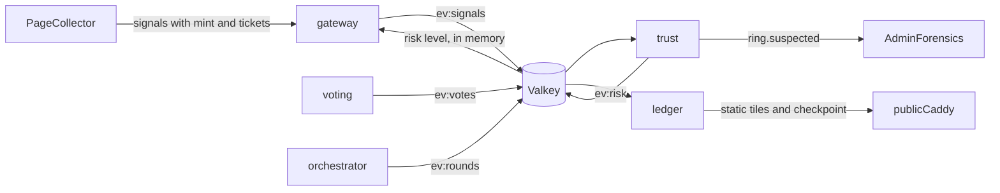

# Word Canvas: advantage plan (anti-bot and concurrency research)

This builds on [word_canvas_v2_028cbab5.plan.md](/Users/somandal/.cursor/plans/word_canvas_v2_028cbab5.plan.md). Everything in v2 still applies unless this plan replaces it.

**Constraints you chose:**
- Fixed close at the end of each minute.
- Exact counts revealed after the close.
- One device, one vote, every vote weighted equally.
- Game rules match [sharedpage.app](https://sharedpage.app/), as set out in v2's round lifecycle:
  - Self-votes are allowed.
  - Submitting casts your vote automatically.
  - Clicking your voted word removes the vote.
  - A tie goes to the earliest submission.
- No login anywhere. Every browser gets an anonymous device session, as described in v2's "Device cost" section.
- Everything runs on the VM; no Cloudflare Workers code. Cloudflare dashboard settings (cache, WAF, Turnstile) are still used.

**What follows from that:**
- Every bot defence acts before a vote counts. A vote is either fully accepted or refused with a clear error code.
- The only way to void a vote after it is cast is a device revocation that happens before the tally.
- With no accounts, a fake voter costs only a new device. So the cost of minting a device, and the per-network budget of devices, carry most of the weight.

## Research verdict (2025 to 2026)

- **Puzzle CAPTCHAs no longer separate humans from AI.**
  - Halligan (USENIX Security 2025) solved 60.7% of 26 CAPTCHA types, and 70.6% of tasks taken from a real CAPTCHA farm.
  - On Open CaptchaWorld (NeurIPS 2025), the best agent scored 40% against 93.3% for humans.
  - "Next-Gen CAPTCHAs" ([arXiv 2602.09012](https://arxiv.org/abs/2602.09012)) reports that GPT-5.2 and Gemini 3 pass about 90% of complex puzzles.
- **Behaviour and fingerprints still do separate them.**
  - FP-Agent ([arXiv 2605.01247](https://arxiv.org/abs/2605.01247)) detected all 7 AI browsing agents it tested; Cloudflare's free protection flagged only 1.
  - [arXiv 2607.26935](https://arxiv.org/abs/2607.26935) reached 100% agent recall with just two features, `mouse_event_rate` and `teleport_click_ratio`. This held even against GAN-generated and replayed human cursor paths, because Playwright-style input never produces the raw pointer-move or wheel streams a real mouse does.
  - Multi-layer fingerprinting ([arXiv 2606.30119](https://arxiv.org/abs/2606.30119)) found that some agents bypassed every anti-bot mechanism tested, yet all agents could still be told apart from humans. Stealth plugins often made them easier to detect, not harder.
- **Attestation is arriving, but unevenly across browsers.**
  - Turnstile already redeems Private Access Tokens on Apple devices.
  - Device Bound Session Credentials (DBSC) are generally available in Chrome 146 on Windows.
  - The Digital Credentials API shipped in Chrome 141 and Safari 26.
  - Passkeys prove nothing about humanity, because Chrome DevTools Protocol (CDP) can create virtual authenticators.
- **Well-behaved agents now sign their requests.** Web Bot Auth (`draft-ietf-webbotauth-httpsig-protocol`, built on RFC 9421) uses a `Signature-Agent` header, and the ChatGPT agent signs with Ed25519.
- **Gaps on Cloudflare's Free plan:** no JA3/JA4 TLS fingerprints and no bot score. TLS ends at Cloudflare, so the origin cannot see TLS fingerprints at all.

**Design consequence:** stay invisible by default and escalate on risk. Use signals that 2026 agents fail (behaviour, environment, coordination), never a puzzle grid. Offer proof of uniqueness as the strongest tier.

## Differentiators (what comparable demos do not have)

1. Zero sign-up, like [sharedpage.app](https://sharedpage.app/): no login screen exists, and every check is invisible unless risk rises.
2. Defences tuned against 2026 AI agents, with a published detection results table (which bot kits were stopped by which layer).
3. A fair close under load: a vote that reaches the gateway in time is never lost to queueing inside our own stack.
4. A tamper-evident essay with transparent moderation: even the admin cannot silently rewrite history.
5. Graceful degradation: priority load shedding, a fallback when Turnstile is down, rolling realtime drains, and recovery from reconnect storms.
6. Correctness that is proven, not claimed: a Quint model of the close saga, Porcupine linearizability checks, and Toxiproxy fault tests.

## Service and data deltas from v2

- **Two new services**, bringing the total to 11:
  - `trust`: risk scoring and coordinated-voting detection.
  - `ledger`: the transparency log.
- **Valkey 9.x** replaces 8. It adds I/O threads, pipeline prefetch and hash field TTL (`HSETEX`). Ticket and step-up state merge into one hash per device, `gw:dev:{device}`.
- **New streams.** Each has a single writer, and its ACL lives in `deploy/valkey/users.acl`:
  - `ev:signals`: written by the gateway, read by trust.
  - `ev:votes`: written by voting, using an `XADD` inside the vote Lua script so the state change and event commit together. Read by trust.
  - `ev:risk`: written by trust, read by the gateway, which keeps an in-memory map, the same pattern as device revocations.
  - Ledger reads `ev:rounds` and `ev:canvas`.
  - Voting now also reads `ev:devices`.
- **New events:** `vote.cast.v1`, `signal.observed.v1`, `device.risk_changed.v1`, `ring.suspected.v1`.

## Anti-bot: risk-tiered admission

**Signals, collected cheaply and privately**
- **Client collector** ([web/src/signals.ts](/Users/somandal/Desktop/personale/word-canvas/web/src/signals.ts)) sends about 30 aggregate numbers with the session mint and each ticket request. It never sends raw cursor paths. The features are:
  - Pointer:
    - `mouse_event_rate`.
    - `teleport_click_ratio`: clicks with no pointer move nearby in the previous 300 ms.
    - Share of events with `getCoalescedEvents()` length above 1.
    - Wheel delta granularity.
    - Mix of pointer types.
  - Keyboard: typing-cadence variance in the word box, and typed versus pasted text.
  - Touch: whether radius and force are present.
  - The `isTrusted` rate.
  - Environment: `navigator.webdriver`, whether `userAgentData` matches the UA header, timezone versus `CF-IPCountry`, whether WebGL2 is present, and the counts of `speechSynthesis` voices and media devices (headless Camoufox leaks these). Also the CDP `Runtime.enable` getter probe, which patchright and rebrowser defeat, so it is a soft signal only.
- **Gateway** checks that headers are consistent: User-Agent against the `Sec-CH-UA*` client hints, `Accept-Language`, and mint network type. It forwards everything to `ev:signals` without waiting.
- **Accessibility guard:** sessions with no pointer data (keyboard, screen reader, switch access) score neutral. Behaviour alone never blocks anyone; it can only trigger a step-up that any human can pass.
- **Privacy:** features only, keyed by device hash, kept 7 days, and disclosed in the privacy note. This is required under India's DPDP Act and GDPR.

**trust service** ([internal/trust](/Users/somandal/Desktop/personale/word-canvas/internal/trust/))
- Starts with a transparent, rule-based score built from:
  - Device age.
  - Mint network type (hosting network or Tor).
  - Mint velocity: how many devices the same network prefix created in the last hour, compared with its usual rate.
  - Whether the device keeps the same key and network over time. Bot fleets churn devices; real browsers persist.
  - First-submit timing: how often the device is among the first submitters right after :00. Earliest-wins ties plus automatic self-votes reward bots that race to submit first.
  - The behavioural and environment features above.
  - Header consistency.
  - The coordination score described below.
- Thresholds stay server-side. Feature logs are kept so a logistic or gradient-boosted model can be trained offline later.
- It emits `device.risk_changed` with a level (`low`, `medium`, `high`, `hold`) and reason codes, and stores only `tr:*` keys.

**Policy ladder (enforced by the gateway at mint and ticket time)**
- **Signed agents:** a valid Web Bot Auth signature, verified with an RFC 9421 library such as `yaronf/httpsign` against the agent's key directory, gets read-only access. Writes return 403 `AGENT_WRITE_FORBIDDEN`. Reads stay open, so the public API is agent-friendly.
- **low:** an invisible Turnstile ticket, valid 10 minutes (as in v2), plus the small proof-of-work paid once at mint.
- **medium:** each ticket also requires an ALTCHA proof-of-work (`altcha-org/altcha-lib-go`). The browser solves it in a Web Worker while the user reads, so it never sits on the click path. Tickets last 5 minutes.
- **high:** an interactive Turnstile check plus a harder proof-of-work. Until they pass, writes return 403 `VERIFICATION_REQUIRED` with a plain-language reason. There is no login to escalate to.
- **hold:** writes are refused and the device goes to admin review.
- **Verified device (stretch tier):** no proof-of-work, 30-minute tickets, higher submit limits, and a way out of `hold`.

**Coordinated-voting detection**
- **Streaming:** port MIDAS-R/F ([Stream-AD/MIDAS](https://github.com/Stream-AD/MIDAS), about 300 lines of count-min sketches) to Go. It runs over edges from a network or behaviour cluster to a `word_id`, in 1-second ticks, so a sudden burst of votes for one word from one network or cluster scores high. Co-submits count as edges too, because with automatic votes, a fleet co-submitting the same text is a vote burst. Constant memory, constant time per vote.
- **Daily batch:** a CopyCatch-style lockstep job finds devices that vote the same words within the same seconds across many rounds. It emits `ring.suspected` with evidence for admin forensics.
- **Auto-revoke only on hard evidence:** a signed agent attempting writes, or lockstep combined with fresh devices on hosting networks. Everything else goes to a human.
- **Voiding:** voting consumes `ev:devices`, and the tally drops votes from devices revoked before `deadline + grace`. This is one binary rule applied to everyone, not weighting.

**When Turnstile is down:** v2 failed closed. Instead, if siteverify errors for more than 30 s, the gateway enters degraded mode:
- Tickets come from proof-of-work at medium difficulty.
- Per-IP limits and per-network mint caps are halved.
- New device mints need a high-difficulty proof-of-work, about 3 to 5 s, solved in the background. Visitors can still join; it just costs more.

Degraded mode is alerted and ends automatically once siteverify recovers.

## Concurrency and fairness

**Fair close under load (arrival-time admission)**
- The gateway stamps `acc_ms` when it accepts the request and puts it in the signed service token. It runs on the same host clock as Valkey.
- The vote Lua script accepts only if `acc_ms < deadline`, `TIME < deadline + 750 ms`, and `|acc_ms - TIME| <= 750 ms`.
- The automatic self-vote uses the submit's `acc_ms` and skips the skew check, because voting applies it from the event stream. Submissions close at :30, so it always lands well before the deadline.
- Vote removals (`word_id: null`) follow the same bounds, so removing a vote at the last moment is as fair as casting one.
- The orchestrator tallies only once `TIME >= deadline + 800 ms` and voting's consumer lag is 0. This changes v2's "final the instant the minute ends".
- `GET /v1/time` performs an NTP-style 4-timestamp exchange. The client takes 5 samples and keeps the lowest-latency one. The countdown subtracts the one-way latency, so "0" means "a vote sent now can no longer arrive".

**Gateway admission control** ([internal/platform/admission](/Users/somandal/Desktop/personale/word-canvas/internal/platform/admission/))
- Priority classes:
  - P0: votes, which are never shed and get their own worker pool.
  - P1: submits, tickets, session mints and refresh.
  - P2: `/me`, `/time`.
- An adaptive concurrency limit (a port of Netflix's Gradient2, about 150 lines; see [Netflix/concurrency-limits](https://github.com/Netflix/concurrency-limits)) covers P1 and P2. Their queues time out after 50 ms, CoDel-style.
- Shed requests get 503 `OVERLOADED` with a jittered `Retry-After` of 1 to 3 s.

**Realtime at 10,000 to 50,000 sockets on 2 cores**
- Heartbeats come from a shared timing wheel. Connections are hashed into 20 one-second buckets, which removes per-connection tickers and the CPU spike of every heartbeat firing at once.
- New SSE connections are accepted at up to 1,500 per second; beyond that, 503 with a random `Retry-After` of 1 to 10 s. Clients reconnect with full-jitter backoff.
- Concurrent replays from the same `Last-Event-ID` share one `XRANGE` (singleflight).
- Two realtime replicas sit behind Caddy and restart one at a time. On SIGTERM, a replica sends `event: reconnect` with `retry` values spread over 0 to 30 s, so its clients move across gradually instead of all at once.
- Two cloudflared replicas run on the same tunnel.
- Memory budget is about 30 KB per connection, so 10,000 connections take about 300 MB; verify this with the loadgen.
- Centrifugo, self-hosted on the VM, is the documented escape hatch above about 50,000 connections.

**Cache and data layer**
- Cloudflare locks the cache on a miss (request collapsing, available on Free). Today's essay adds `stale-while-revalidate=5`. Smart Tiered Cache (free) uses the Oracle region hint, so only the upper tier reaches the origin.
- At the origin:
  - Singleflight on ballot and essay renders.
  - `valkey-go` client-side caching (`DoCache`, using RESP3 tracking) for the ballot list and device flags.

## Smooth experience

- **Sessions and challenges:**
  - No login screen exists. During idle time on first load (`requestIdleCallback`), the page creates the device key, runs invisible Turnstile and solves the mint proof-of-work, so the first click on the red box is instant. Returning visitors reuse the session silently.
  - Turnstile is invisible (`appearance: interaction-only`). It renews in the background, so a ticket is always ready before the next click.
  - Proof-of-work, when required, is solved ahead of time in a Web Worker.
  - A step-up is always a single interactive Turnstile check with a plain-language reason, never a puzzle grid.
- **Votes and the countdown:**
  - Votes are optimistic, with an idempotent retry queue using the same seq until the deadline, plus an offline banner.
  - The countdown is clock-synced and compensates for latency.
- **Page performance and motion:**
  - JavaScript under 40 KB, `preconnect` to `challenges.cloudflare.com`, and immutable hashed assets.
  - Winners are inserted with the View Transitions API, respecting `prefers-reduced-motion`.

## Tamper-evident essay (ledger service)

- Built on [Tessera](https://github.com/transparency-dev/tessera) with its POSIX driver, writing to `/var/lib/ledger` with nightly backup to Object Storage. Signed checkpoints use the C2SP signed-note format, with the key held as a Docker secret.
- **Log entries:**
  - `slot.v1 {day, round, outcome, text_commit = SHA-256(salt || text), tally_hash}`. Canvas or archive serves the text and salt, and the client checks the commit. The salt stops anyone from brute-forcing the text of a hidden short word from its hash.
  - `slot.hidden.v1 {day, round, reason_code, at}`, so moderation is visible.
- Caddy serves `/v1/log/checkpoint` with `max-age=5`. Full tiles are served `immutable` for a year, which suits Cloudflare caching.
- The page verifies inclusion proofs when idle and shows a "verified" mark.
- **No per-vote receipts.** Following MACI's receipt-freeness argument, a receipt would let a vote buyer verify the purchase. Only tallies are logged.
- Stretch: co-signing by witnesses from the C2SP witness network.

## Proving it

- **Red-team harness** (`cmd/redteam`, run locally against the staging stack on the Mac, never against Oracle):
  - It runs Playwright, patchright, rebrowser, Camoufox, browser-use and a computer-use agent through the full vote flow.
  - The README publishes a results table showing which layer stopped each kit, and the false-positive rate on human sessions from the dev team and testers.
- **Quint spec** of the lease, cursor and saga, checked with Apalache. Invariants: one outcome per round, no slot without an outcome, and a cursor that never moves backwards.
- **Porcupine** ([anishathalye/porcupine](https://github.com/anishathalye/porcupine)) checks vote histories from loadgen and chaos runs against a seq-guarded register model. Null values model removals; automatic votes from the event stream and explicit changes race in the same history.
- **[Toxiproxy](https://github.com/Shopify/toxiproxy)** between services and Valkey or Postgres injects latency and resets.
- **New loadgen scenarios:**
  - Reconnect storm: kill one realtime replica with 10,000 clients connected, then measure time to full recovery and origin CPU.
  - Last-second fairness: inject 300 ms of extra latency in front of voting. Every vote or removal stamped before the deadline must take effect.
  - Automatic-vote race: submit, then immediately change or remove the vote while voting's consumer is delayed. The explicit action must always win.

## Ideas considered and dropped

- **Random close, trust-weighted tally, coarse reveal, and Cloudflare Durable Objects fan-out:** dropped by your choice.
- **Google or GitHub sign-in, as a requirement or as a step-up:** dropped by your choice, for zero friction. It made fake voters cost an aged account; the mint cost, per-network device budgets and coordination detection make up for that in part.
- **User passkeys:** without accounts they add nothing, and CDP can create virtual authenticators anyway. Passkeys remain for admins only.
- **Per-device ballot aliases:** would make the ballot uncacheable at the CDN.
- **Hidden decoy words:** the client has to tell them apart, so a bot reading the same JavaScript can too.
- **Private State Tokens:** only useful across sites, and still experimental.
- **Our own Private Access Token issuer:** needs a trusted attester, and Turnstile already redeems PATs on Apple devices.
- **Per-vote receipts:** they enable vote buying.
- **TLS fingerprinting (JA4):** needs Enterprise Bot Management, and TLS ends at Cloudflare anyway.
- **Self's Aadhaar nullifier:** built from guessable fields.
- **Our own puzzle CAPTCHA:** AI agents solve 60 to 90% of them.

## Honest limits

- **A device is a browser, not a person.** One person with several browsers or private windows gets several votes, as on sharedpage.app. Per-network device budgets limit this. Clearing storage only buys a new device at the full mint cost.
- **Solver farms with residential proxies** are the main remaining threat. Without accounts, each fake device costs only a Turnstile solve, a proof-of-work and a fresh home IP. Coordination detection and mint-velocity scoring are the main defences.
- **Human click farms** on real phones pass the behaviour checks. Only proof of uniqueness, per-device and per-network caps, and revocation limit them.
- **First-submitter advantage:** with earliest-wins ties and automatic self-votes, in a quiet round the first word submitted wins if nobody else votes. A bot that races to submit at :00 gains from this. Any word with two votes beats it. The first-submit timing signal and per-network caps limit repeat offenders.
- **Shared IPs:** carrier-grade NAT, offices and campuses can hit the per-network caps. Those users get an interactive Turnstile check, not a block. Tune the caps from real logs.
- **Computer-use agents** that drive a real operating-system cursor produce real pointer streams. The two-feature result applies to CDP-driven agents, so expect adaptation and keep the model retrainable.
- **Arrival-time grace** lets a vote count if it reached the gateway before the deadline but was queued inside the stack for up to 750 ms past it. Document this.
- **The Aadhaar verified tier** needs legal review of UIDAI's offline-verification rules before launch.

## Phasing

- **Phase A (alongside the v2 core):**
  - Fair close and clock sync.
  - Admission control.
  - Realtime hardening.
  - The signals collector, in log-only mode at first.
  - Web Bot Auth.
  - The fallback for when Turnstile is down.
  - UX polish.
- **Phase B:**
  - The trust service with the policy ladder.
  - MIDAS and lockstep detection, with voiding at tally time.
  - The ledger.
  - The red-team results table, Quint, Porcupine and Toxiproxy.
- **Phase C (stretch):**
  - An optional verified-device tier that is still not a login: [Anon Aadhaar](https://github.com/anon-aadhaar/anon-aadhaar) (its app-scoped nullifier suits an India-first audience), or [zkPassport](https://zkpassport.id) for everyone else.
    - Only the hashed nullifier is stored.
    - Each nullifier has one active device; proving again on a new device moves the status and revokes the old device.
  - DBSC binding of the device session in Chrome 146+ ([spec](https://w3c.github.io/webappsec-dbsc/)), replacing the WebCrypto key proof with a hardware-backed key where available.
  - A trained risk model.

## Sources (beyond those linked above)

Halligan (USENIX Security 2025), Open CaptchaWorld (NeurIPS 2025), [arXiv 2605.14786](https://arxiv.org/abs/2605.14786) (UI traces identify the underlying model), MIDAS (AAAI 2020) and MIDAS-F (TKDD 2022), CopyCatch (WWW 2013), [RFC 9421](https://www.rfc-editor.org/rfc/rfc9421), [Cap](https://github.com/tiagozip/cap), [ALTCHA](https://github.com/altcha-org/altcha), [valkey-go](https://github.com/valkey-io/valkey-go), [Quint](https://github.com/informalsystems/quint), [MACI](https://maci.pse.dev), Valkey 9.0 release notes, and Cloudflare cache, tiered cache and Turnstile docs.
