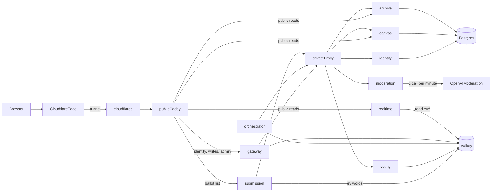
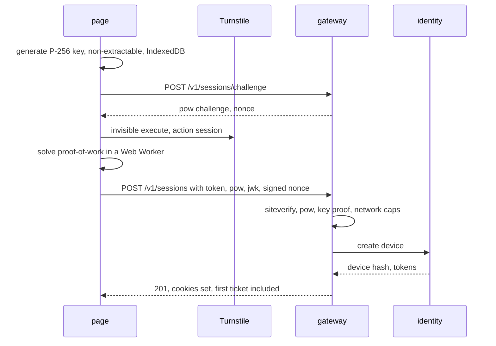
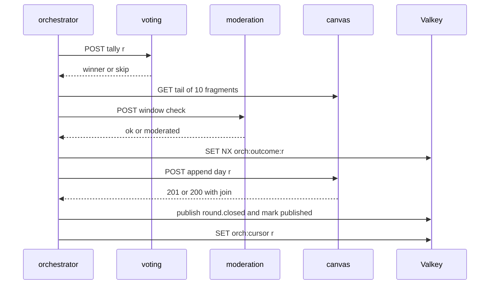

# Word Canvas v2: hardened plan

## Verdict on the review

All seven must-fix items are real bugs, and all are adopted, along with the scaling, architecture and cleanup points. Research added these, which the review missed:

- Oracle Always Free A1 is now 2 OCPU and 12 GB in total, and it is **Arm64**, so every image must be built for arm64. An instance counts as idle only when CPU (95th percentile), network and memory are all under 20% for 7 days. Oracle's docs confirm that Always Free resources stay free after an upgrade to Pay As You Go. That the upgrade also stops reclaim is still only community-reported.
- Canvas and archive both writing `days`/`slots` is the same shared-database problem as the Redis keys. Split it: canvas owns the live day, archive owns sealed snapshots.
- Routing public reads from Caddy straight to realtime and canvas makes those services reachable from the internet. If one were compromised, it could forge `X-Device-Id` toward voting. So internal calls carry a short-lived signed service token.
- Cloudflare Tunnel replaces the open port 443 and the Cloudflare IP allowlist. The VM has no inbound ports, so `CF-Connecting-IP` is trustworthy by construction. Tunnel buffers responses unless they are `text/event-stream`, and Cloudflare drops connections that stay idle for 100 s.
- Bot Fight Mode must stay off. On the Free plan it cannot be skipped, and it challenges `fetch` and SSE calls.
- A CDN purge cannot reach browser caches, so sealed days use a short browser TTL and a long CDN TTL with `Cache-Tag`. Purge-by-tag is available on the Free plan (5 requests/min).
- Exact matching on token spans misses `xfu` + `ck`. The window check also needs a substring pass, over a short list of severe terms, that only counts matches crossing into the new fragment.
- INCR/DECR counters can drift. Tally from the votes hash instead.
- The review's co-submitter and own-word items no longer apply. Rules now match sharedpage.app: self-votes are allowed, and submitting casts your vote automatically. A solo visitor's word therefore wins its round.
- Earliest-wins ties plus automatic self-votes give an edge to whoever submits first in each round. A bot can race to submit at :00. Defences:
  - Two votes from humans beat it.
  - The advantage plan scores devices that are consistently first to submit.
- Licenses are clear: `glin-profanity` MIT, `remove-profanity` MIT, LDNOOBW CC BY 4.0. OpenAI `omni-moderation-latest` is free (the free tier allows 250 requests/min and 5,000/day), which covers one call a minute.

**What "real users only" can mean:** no web app can guarantee humans only, because paid CAPTCHA solvers exist. With no login, "one vote" means one browser, not one person. One person with several browsers or private windows gets several votes; [sharedpage.app](https://sharedpage.app/) works the same way.

What the design does:
- Each new device costs a Turnstile solve, a proof-of-work and a slot in its network's device budget.
- Each device holds a non-extractable key, so one session can't be cloned across a bot fleet.
- Writes then need a fresh ticket every 10 minutes, and each device votes once per round.
- Forensics plus revocation remove the bots that get through.

The advantage plan adds behavioural and coordination checks on top. The main remaining threat is solver farms combined with residential proxies: network caps and coordination detection limit it but cannot eliminate it.

## Stack and repo

- New repo at `~/Desktop/personale/word-canvas`, remote `git@github-personal:jokerinfini/word-canvas.git`. Create and push only when asked. If the v1 scaffold from `d:\mendr\colorbook` is available, copy the useful parts; otherwise start fresh.
- Go: current stable release, at least 1.25 (for container-aware GOMAXPROCS).
- HTTP: standard library `net/http` mux, with `oapi-codegen` strict servers.
- Data: `valkey-go` (automatic pipelining); `pgx` v5 with `sqlc` and `goose`.
- Sessions and text:
  - `golang-jwt/jwt/v5`: EdDSA for access tokens and ES256 for device-key proofs, nothing else.
  - `altcha-org/altcha-lib-go` for proof-of-work.
  - `go-webauthn/webauthn` for admin passkeys only.
  - `golang.org/x/text` for NFKC and casefolding.
  - No OAuth or OIDC libraries: there is no user login.
- Valkey 8 (BSD) instead of Redis, which moved to an AGPL/SSPL/RSAL tri-license. Lua, Streams and ACLs work the same.
- Frontend: Vite with vanilla TypeScript and no framework.
- Layout:
  - `cmd/<service>`: one binary per service.
  - `internal/<service>`: each service's private code.
  - `internal/platform/*`: shared code (clock, problem+json, request ID, service tokens, text normalization, join rule).
  - A `depguard` rule stops one service's package importing another's.
  - `api/openapi/*.yaml`, `api/asyncapi/events.yaml`, `deploy/`, `data/blocklist/`, `web/`.

## Architecture

There are nine services:

- **gateway**: the public API for anything that needs a device session. It runs every human-proof check: session mints (Turnstile, proof-of-work, device-key proof, per-network mint caps), Turnstile tickets and rate limits. It also verifies the access token locally and handles CSRF checks and request IDs. It builds `/me` from two services, signs service tokens and forwards through the private proxy. Admin routes get their own listener.
- **identity**: anonymous device records, refresh tokens with device-key proofs, revocation, admin passkeys and the signing-key set (JWKS). Uses Postgres schema `identity`.
- **submission**: normalizes text, calls moderation, owns the ballot keys and emits `word.approved` atomically. Also serves the public ballot list.
- **moderation**: stateless. Holds the word lists and runs the span and window checks. It is the only service with the OpenAI key.
- **voting**: builds its own candidate set from `ev:words`, runs the vote script and the tally.
- **orchestrator**: a singleton behind a lease. It closes rounds as an idempotent saga and seals days.
- **canvas**: today's essay, append, seal, hide and the spacing (join) rule. Uses schema `canvas`.
- **archive**: sealed-day snapshots, 31-day retention and CDN purges. Uses schema `archive`.
- **realtime**: two SSE streams, fed from Valkey Streams.

**Routing rule.** Public, anonymous, cacheable reads go from public Caddy straight to their owner:
- `/v1/events*` goes to realtime.
- `/v1/canvas/today` goes to canvas.
- `/v1/canvas/{day}` goes to archive.
- `GET /v1/rounds/{id}/words` goes to submission.

Everything that needs a device session goes through the gateway. `/internal/*` is never routed publicly and is also blocked by a firewall (WAF) rule.

**Service tokens.** The gateway and the orchestrator sign an Ed25519 JWT for each internal call:
- `aud` is the target service and `exp` is 30 s.
- `sub` is the device hash on user calls, and `role` is `gateway` or `orchestrator`.

Services reject calls without a valid token, and tally and seal accept only `role=orchestrator`. Keys come from Docker secrets.

## Identity and anti-bot layers

**1. Edge (Cloudflare Free plan)**
- Traffic arrives over the Tunnel only. The OCI security list has no inbound rules, and SSH goes through OCI Bastion or a Cloudflare Access SSH app.
- WAF custom rules (the Free plan allows 5):
  - Block `/internal*`.
  - Block writes that lack the `X-WC-CSRF` header.
  - Send session mints and writes from Tor (`T1`) and hosting networks to a Managed Challenge. The hosting networks are AWS 16509/14618, Azure 8075, DigitalOcean 14061, OVH 16276, Hetzner 24940, Linode 63949, Vultr 20473 and Oracle 31898. Real users pass through Turnstile pre-clearance (`cf_clearance`).
  - Keep two rules spare for incidents.
- The one Free rate-limit rule: 20 requests per 10 s per IP on `/v1/sessions`.
- Bot Fight Mode off.

**2. Device cost (no login)**

There is no sign-in screen anywhere. Reading never needs a session. The page creates one silently during idle time on first load, so the first click on the red box is instant.

- **Device key.** WebCrypto ECDSA P-256 with `extractable: false`, stored in IndexedDB. The private key never leaves the browser.
- **Challenge.** `POST /v1/sessions/challenge` returns a stateless, HMAC-signed ALTCHA proof-of-work challenge and a nonce. Difficulty depends on the network: about 0.5 s on a mid-range phone normally, harder for risky networks.
- **Mint checks (gateway).**
  - Turnstile siteverify: `success`, `hostname`, `action=session`, `cdata` equal to the key's JWK thumbprint, token age under 300 s, with `remoteip` and `idempotency_key`.
  - The proof-of-work solution.
  - A device-key signature over the nonce.
- **Per-network mint caps (gateway, GCRA).** These are starting values, tuned from logs:
  - 20 new devices per IPv4 address per hour, because carrier-grade NAT shares addresses.
  - 200 per IPv4 /24 per day.
  - 5 per IPv6 /64 per day, because mobile carriers such as Jio give each phone its own /64.
  - 50 per IPv6 /56 per day.
  - Over a cap, the mint needs an interactive Turnstile check instead of failing.
- **Stored (identity):**
  - `device_hash = HMAC(pepper, jwk_thumbprint)`, `created_at`, and an HMAC of the mint network prefix, plus ASN and country.
  - No email, no name, no raw IP.
  - Devices that never write are deleted after 7 days.

**3. Session**
- **Access token:** an EdDSA JWT valid for 10 min, in cookie `__Host-wc_at` (HttpOnly, Secure, SameSite=Strict). `sub` is the device hash and `cnf.jkt` is the key thumbprint. The gateway pins the algorithm, issuer and audience, and caches verified tokens by hash to save CPU on 2 cores.
- **Refresh token:** opaque, 256-bit, rotated on every use and stored hashed, in cookie `__Secure-wc_rt` with `Path=/v1/sessions`, sliding 30 days.
  - Each refresh also carries `WC-Proof`, a JWS from the device key over `{nonce, htu, iat}`. A copied cookie is useless without the key, so a bot farm cannot clone one session across many bots.
  - Reusing a spent token revokes its whole family.
- **Silent recovery:** the client refreshes silently, and the user never sees a session screen. If storage is cleared, the page mints a new device, which pays the full mint cost and gets fresh limits.
- **Revocation:** identity emits `device.revoked` on `ev:devices`. The gateway keeps an in-memory deny set for 10 min, and identity refuses refresh.
- **Forget this device:** `DELETE /v1/sessions/current` deletes the device record, for privacy.
- **CSRF:** SameSite=Strict, `Origin` must equal the site, `Sec-Fetch-Site: same-origin`, plus the custom header `X-WC-CSRF: 1`.
- **Passkeys exist only for admins**, as the required step-up for admin actions.

**4. Human proof per time window**
- The Turnstile solve at mint counts as the first ticket. After that, writes need a ticket: `POST /v1/tickets {turnstile_token}` with `WC-Proof`.
- The gateway calls Turnstile's siteverify with `remoteip` and an `idempotency_key`. It checks `success`, `hostname`, `action=write`, `cdata` (bound to the device hash) and a token age under 300 s.
- A valid ticket is stored as `gw:tk:{device}` for 10 min. The client renews it in the background with an invisible `turnstile.execute()` a minute before expiry.
- If siteverify is down, writes fail closed. The advantage plan replaces this with a proof-of-work fallback.

**5. Limits.** A single gateway Lua call runs the rate limiter (GCRA), the network caps and the ticket check, so each request costs one Valkey round trip.
- **Per device:** 30 vote changes per round, 3 submit attempts per minute, 60 `/me` calls per minute, 5 reports per day.
- **Per network per round:** up to 50 distinct devices may vote from one IPv4 address and 4 from one IPv6 /64. Further devices get 403 `VERIFICATION_REQUIRED` (an interactive Turnstile check) before their vote is accepted, rather than a hard refusal.
- **Per IP:** 1,200 API requests per minute (generous, for shared mobile IPs), the mint caps above, and 20 concurrent SSE connections.
- **Requests:** bodies are capped at 1 KB and parsed as strict JSON (unknown fields rejected). Over-limit calls get 429 with `Retry-After`.

**6. Bounding each device's influence:** one vote per device per round (including its automatic self-vote), hidden counts and a ballot cap.
- Admin forensics show the winner's votes by network (ASN), country, device-age bucket and mint network.
- Admins can revoke devices, and can throttle a network prefix (`gw:throttle:{net}`) so that new mints from it need interactive Turnstile for 24 h.

**7. Platform**
- Valkey ACL user per service, and a Postgres role per schema.
- Distroless, non-root images with a read-only root filesystem, `cap_drop: ALL` and `no-new-privileges`.
- The data network is `internal: true`, and secrets are Docker secrets.
- CI runs `gitleaks`, `govulncheck`, `gosec` and `trivy`, and images are pinned by digest.

**8. Browser**
- Strict CSP: `script-src 'self' https://challenges.cloudflare.com`, `frame-src https://challenges.cloudflare.com`, `worker-src 'self'` (proof-of-work worker), `connect-src 'self'`, `frame-ancestors 'none'`, plus Trusted Types.
- HSTS, and user text is only ever rendered with `textContent`.

## Round lifecycle

**Clock.** Valkey `TIME` is the only clock. `round = floor(ms / 60000)`, and submission is open while `ms % 60000 < 30000`. Phase is computed, never stored. The day is the local date in `DAY_TZ` (default `Asia/Kolkata`). A round is the last of its day when `day(r) != day(r+1)`.

**Game rules (matching [sharedpage.app](https://sharedpage.app/)):**
- You may vote for any word, including your own.
- Submitting a word casts your vote for it automatically, and the same holds when you co-submit an existing word. Because submitting is the later action, it moves any earlier vote. You can change or remove the vote at any time until the minute ends.
- Clicking the word you voted for removes your vote, and clicking another word moves it.
- At the close, the word with the most votes wins. A tie goes to the earliest-submitted word. If no word was submitted or no votes remain, the round is skipped.

**Submit (`POST /v1/rounds/{id}/words {text, vote_seq}`).** `vote_seq` is the client's next vote seq, used for the automatic vote. Submission normalizes the text, calls moderation (150 ms timeout, fail closed), then runs one Lua script:
- `TIME` check; if the window has passed, `SUBMISSION_CLOSED`.
- If this device already submitted: the same text returns 200 with the original word and emits nothing new; different text returns 409 `ALREADY_SUBMITTED`.
- If the exact text is already on the ballot, the device is added as a co-submitter. The script emits `word.cosubmitted {word_id, device, vote_seq, acc_ms}` and returns 200 with that word.
- If the ballot is full (default 300 words), 409 `BALLOT_FULL`.
- Otherwise it creates `word_id = "{round}.{n}"`, where `n` is a per-round counter assigned inside the script. Submissions are therefore totally ordered, and `n` defines "earliest". In the same script it runs `XADD ev:words` with `word.approved {word_id, text, device, vote_seq, acc_ms}`, so the state change and its event commit together (no dual write).
- Every key gets `EXPIRE 7200 NX`.
- The response includes `my_vote {word_id, seq: vote_seq}`, so the page shows the word as voted immediately.

**Vote (`PUT /v1/rounds/{id}/vote {word_id | null, seq}`).** `word_id: null` removes the vote. Removal goes through the same seq guard: a plain `DELETE` could be overtaken by a delayed older `PUT` that brings the vote back. One Lua script, touching voting's keys only:
- `TIME` check: a past round returns `VOTING_CLOSED` and a future round returns `ROUND_NOT_OPEN`, so the tally is final the instant the minute ends.
- A non-null word missing from `vt:cand:{r}` returns 409 `UNKNOWN_WORD`. The client retries once after 300 ms, because voting's consumer trails submissions by milliseconds.
- If the stored seq is greater than or equal to the new one, the result is 200 `{status:"stale"}` with the stored vote.
- Otherwise `HSET vt:votes:{r} voter "word|seq"`. A removal stores the tombstone `"|seq"`, which keeps the seq so older requests stay stale.

**After a reload.** `GET /v1/rounds/{id}/me` (the gateway queries voting and submission in parallel) returns `my_vote {word_id | null, seq}` and `my_word`, so the client resumes with `seq = my_seq + 1`. If the automatic vote has not been applied yet (`/me`'s seq is lower than the page's own), the page keeps its optimistic state.

**Candidate set and automatic vote.** Voting reads `ev:words` through the consumer group `voting`. For each `word.approved` or `word.cosubmitted` event, it:
1. Runs `HSET vt:cand` (idempotent).
2. Applies the submitter's vote through the same vote script, using the event's `vote_seq` and `acc_ms`. Because of the seq guard, a replayed event is harmless, and so is a later explicit change or removal that arrives first.
3. Runs `XACK`.

On restart, `XAUTOCLAIM` picks up anything left unacknowledged.

**Tally (internal, orchestrator only).**
- Wait until the consumer group's lag is 0 (up to 2 s; otherwise return 503).
- Read `vt:votes:{r}`, skip tombstones, count, and store `vt:result:{r}` with `SET NX`.
- A unique top word wins. A tie goes to the tied word with the lowest `n`, compared numerically, not as a string. No words, or no votes left, means skip.

**Close saga (orchestrator)**

- **Lease.** `orch:lease` uses `SET NX PX 3000` and is renewed every second by compare-and-extend. An orchestrator that loses the lease stops its loop.
- **Catch-up.** `orch:cursor` records the last finished round. Every 250 ms the orchestrator processes rounds `cursor+1 .. current-1`, up to 120 rounds back. Older rounds are recorded as `expired`, since their keys live for 2 h.
- **Idempotent steps.**
  - Tally, then the window check.
  - `SET NX orch:outcome:{r}`: the first writer wins, so a retry can't change a decision.
  - Canvas append.
  - One Lua call that both runs `XADD ev:rounds` and sets `orch:published:{r}`.
  - Advance the cursor.
- **Midnight.** Only after the day's last round is appended:
  - Canvas seals the day and returns a snapshot. Any later append gets 409 `DAY_SEALED`.
  - Archive stores it via `PUT /internal/v1/days/{day}`, idempotent by content hash.
  - Canvas drops its live rows, and a `day.sealed` event goes out.

## Data ownership

**Valkey.** Settings: `noeviction`, `maxmemory 1gb`, AOF `everysec`, default user disabled. The ACL file is [deploy/valkey/users.acl](/Users/somandal/Desktop/personale/word-canvas/deploy/valkey/users.acl).

- gateway: `gw:*` (limits, tickets, mint caps, network throttles) and `TIME`; reads `ev:devices`.
- submission: `sub:*`; write-only on `ev:words`.
- voting: `vt:*`. On `ev:words`, an ACL selector allows only `XREADGROUP`, `XACK`, `XAUTOCLAIM` and `XINFO`.
- orchestrator: `orch:*`; write-only on `ev:rounds`.
- canvas writes `ev:canvas`; archive writes `ev:archive`; identity writes `ev:devices`.
- realtime: read-only on `ev:*`.

Each stream has exactly one writer and is capped with `XADD MAXLEN ~`. Event schemas are versioned in `api/asyncapi/events.yaml`: `word.approved.v1`, `word.cosubmitted.v1`, `round.closed.v1`, `slot.hidden.v1`, `day.sealed.v1`, `device.revoked.v1`.

**Postgres.** One schema and one role per owning service, each with grants only on its own schema.

- identity: `devices`, `refresh_tokens`, `admin_passkeys`.
- canvas: `days(day pk, sealed_at)`, `slots(day, round_number, text, hidden_at, hidden_reason, pk(day, round_number))`, `reports`.
- archive: `sealed_days(day pk, slots jsonb, content_hash, hidden_version)`.

A canvas append is one transaction:
- `SELECT … FOR SHARE` on the day row, so the seal's `UPDATE` waits for it.
- Reject if the day is sealed.
- `INSERT … ON CONFLICT DO NOTHING`. An existing row with the same text returns 200; different text returns 409 `SLOT_CONFLICT`.

## Moderation

**Normalize** (shared `internal/platform/textnorm`, used by both submission and moderation):

1. Apply NFKC, so fullwidth `ｈｅｌｌｏ` becomes `hello`.
2. Whitelist code points:
   - Allowed: Latin letters (Basic Latin, Latin-1 Supplement, Latin Extended-A), the ASCII space, and the prose marks `. , ! ? ; : ' " - — – … ( ) [ ] { } ‘ ’ “ ” & /`.
   - Everything else is 422 `BAD_WORD`: digits, combining marks (as in Zalgo text), zero-width characters, bidirectional controls, variation selectors and non-Latin look-alikes.
3. Trim the ends and collapse runs of internal spaces to one.
4. Allow 1 to 48 characters and at most 3 tokens, splitting on spaces, hyphens, dashes and slashes.

**Letter core:** casefold, strip accents, drop punctuation marks.

**Word check.** Every contiguous span of tokens (at most 6 spans for 3 tokens) has its core looked up in the four v1 tiers:
1. LDNOOBW plus the glin Latin lists.
2. The Indic phonetic skeleton, behind the English allowlist.
3. Arabizi and Russian transliteration.
4. Chinese, Japanese and Korean romanization.

`hello bhenchod` is caught by its second token, `fu ck` by the joined span, and `f u c k` by the token cap.

**Window check (once per winner).**
- Take the tokens of the last 10 fragments plus the candidate. Every span of up to 8 tokens that ends inside the candidate goes through the same tiers.
- A multi-pattern (Aho-Corasick) substring pass over the joined core then looks for a short list of severe terms of 4 or more letters. Only matches that cross into the candidate count, which catches `xfu` + `ck`.
- Then one OpenAI `omni-moderation-latest` call on the joined text, with a 2 s timeout.
- Any flag makes the outcome `moderated`, so nothing is appended. If the AI call times out, the check fails open and is logged. The deterministic checks stay authoritative, because the AI is weaker on romanized Hinglish.

**Operations.** Lists reload without a restart, and every response carries `lists_version`. Licenses live in `data/blocklist/*/LICENSE` and `THIRD_PARTY_NOTICES.md`.

**Tests.**
- A false-positive corpus that must all pass: SCOWL size-50 English, US SSA first names (public domain), 500 curated Indian first names and place names, and Scunthorpe cases (`classic`, `assassin`, `Sussex`, `Dickens`, `cocktail`).
- Obfuscation cases: zero-width characters inside a slur, Cyrillic look-alikes, fullwidth letters, combining marks.

**Takedown.**
- Admin calls `PATCH /v1/admin/days/{day}/slots/{round} {hidden, reason}`. The owner (canvas for today, archive for sealed days) sets `hidden_at` and emits `slot.hidden`. It then purges Cloudflare by tag `day-YYYY-MM-DD`, using a zone-scoped token that can only purge cache.
- Sealed days send `Cache-Control: public, max-age=300, s-maxage=86400` with `Cache-Tag` and `ETag`, so browsers drop a hidden slot within 5 minutes.
- Users can report a slot (`POST /v1/canvas/{day}/slots/{round}/reports`). Reports never hide a slot automatically, since that would let a brigade censor.

**Spacing.** The server computes a stateless pairwise `join(prev, next)` on read, against the previous visible slot. It is returned for every fragment and included in `round.closed`.
- No space if `next` starts with `. , ! ? ; : … ) ] } ’ ” - — – /`.
- No space if `prev` ends with `( [ { ‘ “ - — – /`.
- A fragment that is only straight quotes attaches to the previous fragment. A quote attached to a word (`"hello`, `hello"`) is simply part of that word.
- Otherwise, one space. A stray quote affects one junction, never the rest of the day.

## Realtime and page

**Streams**
- `/v1/events` (always open) carries:
  - `round.open`: includes `server_time` and resyncs the countdown.
  - `round.closed`.
  - `slot.hidden`: the client refetches today's essay.
  - `day.sealed`.
- `/v1/rounds/current/events` is open only while the Type dialog is: one `words.batch` per second.

**Delivery**
- The event `id` is the stream ID. A reconnect with `Last-Event-ID` replays via `XRANGE`. If that ID has been trimmed, realtime sends `reset` and the client refetches the essay and ballot.
- Winners carry `round_number`, so the client inserts them in order and drops duplicates.
- A heartbeat comment goes out every 20 s, with `retry: 3000` plus client jitter.
- Headers: `Content-Type: text/event-stream`, `Cache-Control: no-cache`, `X-Accel-Buffering: no`, and no compression.

**Fan-out**
- Each batch is encoded once and the same bytes go to every subscriber.
- Each client gets a buffer of 16 messages and a write deadline via `http.ResponseController`. Slow clients are dropped.
- Connections are capped at 20 per IP and 20,000 in total, beyond which realtime returns 503 with `Retry-After`.

**Fallback.** After 3 failed reconnects, the client polls `GET /v1/canvas/today?after={round}` every 5 s, which Cloudflare can cache. This matters because Cloudflare supports SSE less formally than WebSockets.

**Page**
- The ballot is shuffled with a random per-device seed stored in `localStorage`, sorted by `hash(seed, word_id)`, so new words slot in without reshuffling. `shuffle_seed` is dropped from the API.
- No login screen. The device session is minted silently during idle time on first load and refreshed in the background.
- Votes are optimistic, using the seq from `/me`.
  - Clicking another word moves the vote.
  - Clicking the voted word sends `word_id: null` to remove it.
  - Each word is a toggle button with `aria-pressed`, so screen readers announce the current vote.
  - After a submit, the page marks your word as voted at once.
- The countdown is driven by the offset from server time.
- The dialog traps focus, and winners are announced through `aria-live`.

## Public API (OpenAPI 3.1; errors as problem+json per RFC 9457)

- Device sessions (no login):
  - `POST /v1/sessions/challenge` returns `{pow_challenge, nonce}`.
  - `POST /v1/sessions {turnstile_token, pow, device_jwk, proof}` returns 201 and sets both cookies.
  - `POST /v1/sessions/refresh` with the `WC-Proof` header.
  - `DELETE /v1/sessions/current` (forget this device).
- `GET /v1/me` and `POST /v1/tickets` (with `WC-Proof`).
- `GET /v1/rounds/current` returns `round_id`, `server_time_ms`, `submit_closes_at_ms`, `vote_closes_at_ms` and `day`.
- `GET /v1/rounds/{id}/me`.
- `POST /v1/rounds/{id}/words {text, vote_seq}` returns 201 with `Location`, or 200 for a retry or a co-submit, with `my_vote` in the body.
- `GET /v1/rounds/{id}/words` (with `ETag`).
- `PUT /v1/rounds/{id}/vote {word_id | null, seq}` (null removes the vote).
- `GET /v1/events` and `GET /v1/rounds/current/events`.
- `GET /v1/canvas/today[?after=]`, `GET /v1/canvas/days` and `GET /v1/canvas/{day}`.
- `POST /v1/canvas/{day}/slots/{round}/reports`.
- Admin (admin host only):
  - `PATCH /v1/admin/days/{day}/slots/{round}`.
  - `POST /v1/admin/devices/{id}/revoke` and `POST /v1/admin/networks/{prefix}/throttle`.
  - `GET /v1/admin/reports` and `GET /v1/admin/rounds/{id}/forensics`.
  - `POST /v1/admin/passkeys/{register|login}/options` and `POST /v1/admin/passkeys/{register|login}`.

**Error codes**
- Sessions and limits: `SESSION_REQUIRED` (the client mints or refreshes silently and retries), `DEVICE_REVOKED`, `TICKET_REQUIRED`, `VERIFICATION_REQUIRED`, `RATE_LIMITED`.
- Submit: `SUBMISSION_CLOSED`, `ALREADY_SUBMITTED`, `BALLOT_FULL`, `BAD_WORD`, `WORD_REJECTED`.
- Vote: `VOTING_CLOSED`, `ROUND_NOT_OPEN`, `UNKNOWN_WORD`.
- Canvas: `DAY_SEALED`, `SLOT_CONFLICT`.

A stale vote returns 200, not an error. The `seq` field on words is removed.

## Edge and deploy

- **Host:** Oracle A1 with 2 OCPU and 12 GB, running Ubuntu 24.04 arm64. Images are built for both arm64 and amd64.
- **Request path:** cloudflared, then public Caddy, then the services.
  - Caddy routes by host and path. It trusts only cloudflared as a proxy and reads the client IP from `CF-Connecting-IP`.
  - Caddy strips any inbound `X-Device-Id`, `X-Internal-*` and `X-Request-ID`, and the gateway overwrites them anyway.
  - The private Caddy listens only on the internal service network.
- **Admin** lives on `admin.<domain>` behind Cloudflare Access (free for up to 50 users). The gateway's admin listener validates `Cf-Access-Jwt-Assertion` (RS256, the team's signing keys, and the app's `aud`). Mutations also need an allowlisted Access identity and a fresh admin passkey.
- **Cache Rules** cache only `/v1/canvas/*`, `/v1/rounds/*/words` and `/assets/*`, respecting origin TTLs. Today's essay uses `s-maxage=5` and the ballot `s-maxage=1`; check with `cf-cache-status`. Everything else is `private, no-store`.
- **Turnstile:** one Managed widget with pre-clearance enabled, and test keys in dev and CI.
- **Open files:** raise `ulimit -n` to 1,048,576 for cloudflared, Caddy, gateway and realtime.
- **Oracle reclaim:**
  - Upgrade to Pay As You Go, with a $1 budget alert and compartment quotas.
  - Don't run synthetic load; users report it can get an account terminated.
  - Run a nightly `pg_dump` to OCI Object Storage, so the box can be rebuilt from compose in under an hour.
- **Hot path:** a vote goes Cloudflare, cloudflared, Caddy, gateway, private proxy, voting. Load-test vote and submit with and without the private proxy. If p99 latency misses the target, point those two upstreams straight at the service (a config change only).

## What reviewers see

- **Request IDs.** Caddy reuses `CF-Ray` or generates an ID. `X-Request-ID` and W3C `traceparent` flow through the gateway, the proxy and every service, and the `slog` JSON logs include both.
- **Health and metrics.** `/healthz` (liveness) and `/readyz` (Valkey and Postgres reachable), plus `/metrics` on an internal port. An optional compose profile adds Prometheus and Grafana.
- **API contracts.** One OpenAPI file per service, generated handlers, and a CI check for Spectral lint and generated-code drift. AsyncAPI documents the events.
- **Simulator.** `cmd/simulator` is built only with the `devsession` build tag, which mints sessions without Turnstile or proof-of-work, so that path never ships in the prod binary. Its personas submit, vote and change votes using public-domain fragments.
- **Load generator.** `cmd/loadgen` runs 10,000 SSE listeners, 2,000 submits in 30 s and 10,000 votes in the final 2 s, from the Mac against staging. Targets to verify, not promises: origin vote p99 under 25 ms, and a winner reaching 10,000 listeners in under 1 s.
- **Chaos demo.** Hooks compiled only with the `chaos` build tag cover five scenarios:
  - Kill the orchestrator between outcome and append.
  - Kill canvas before commit.
  - Kill realtime.
  - Kill voting mid-batch.
  - Run two orchestrators and kill the leader.

  An invariant checker then proves one outcome per round, at most one slot per round, and no missing winner in any client's essay.
- **README.**
  - Why microservices here: the vote burst, SSE fan-out and cold archive scale separately, ownership is clear, and failures are isolated.
  - What they cost: extra hops, more operations work, and distributed failure modes.
  - It ends with "I'd start as a modular monolith".
  - It also notes the first-submitter advantage that comes from earliest-wins ties.
